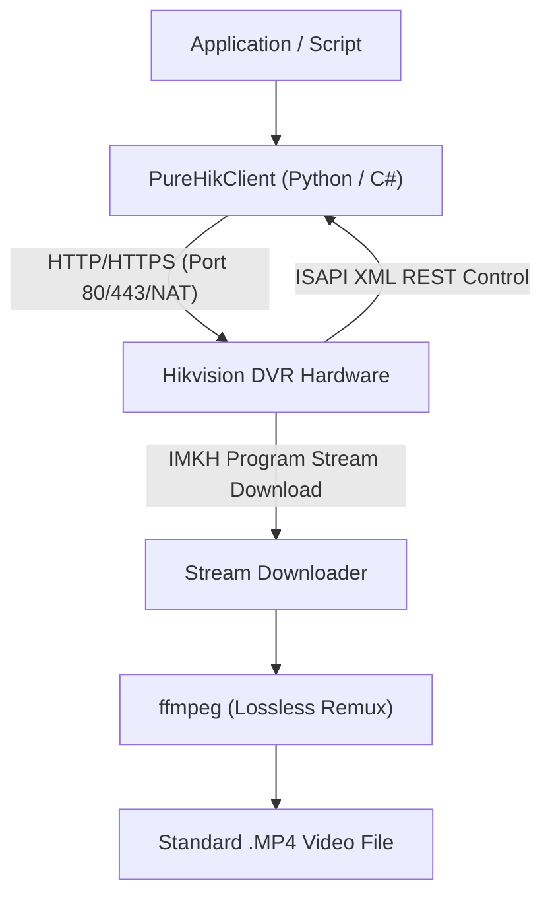

# OpenHik-DVR

> **Open-Source Client Libraries, ISAPI REST Protocol Specifications, and Tooling for Hikvision DVRs, NVRs, and IP Cameras (Zero DLLs)**

[](https://opensource.org/licenses/MIT)
[]()
[]()

---

## 📌 Overview

Hikvision DVRs, NVRs, and IP cameras are deployed by the millions worldwide. Traditional automation with these systems has historically relied on proprietary, closed-source C/C++ libraries (`HCNetSDK.dll`) or legacy Internet Explorer ActiveX controls (`WebCtrl.ocx`), which do not run on modern mobile platforms, ARM devices, or cloud environments.

**OpenHik-DVR** provides a modern, clean-room implementation of the **Hikvision ISAPI (Intelligent Security API)** over standard HTTP/HTTPS:

1. **Zero Native Dependencies:** Connect, authenticate, query, and download using standard HTTP sockets and Digest Authentication (RFC 2617). No proprietary DLLs required.
2. **Cross-Firmware Architecture:** Tested and verified across both **Classic V3.x** (`std-cgi.com` schema) and **Modern V4.x+** (`hikvision.com` schema) firmware architectures.
3. **High-Speed Direct Downloads:** Pulls footage directly from internal DVR hard drive sectors at up to **25+ MB/s** on local networks and maximum line rate over the internet.
4. **Instant Lossless MP4 Remuxing:** Packages raw Hikvision Program Streams (`IMKH` PS container) into standard MP4 files in milliseconds with `ffmpeg`.
5. **Live JPEG Snapshot Grabbing:** Captures real-time camera frames over HTTP GET.
6. **Full Telemetry & Hardware Control:** Read/write system clock, rename camera OSD channels, query HDD status and storage capacity, inspect CPU load/uptime, and receive real-time motion detection push alerts.

---

## 🔬 Hardware Verification Matrix

OpenHik-DVR has been verified on live physical hardware:

| Model | Architecture | Firmware | Interface | Tested Download Speed |
|:---|:---|:---|:---|:---:|
| **DS-7116HQHI-K1** | 16-Channel 1080p Full HD DVR | `V3.5.20` (build 170808) | LAN (HTTP 80) | **~25.0 MB/s** |
| **DS-7116HGHI-K1** | 16-Channel 1080p Lite Mini DVR | `V4.70.170` (build 220610) | WAN / Internet (HTTP) | **~2.6 MB/s** (Upstream Bound) |

---

## 🏗️ Architecture



---

## 🚀 Quick Start (Python - Zero Dependencies)

Runs on Python 3.7+ across Windows, Linux, macOS, Android (Termux/Kivy), and Raspberry Pi:

```python
from datetime import datetime, timedelta
from python.pure_hik_client import PureHikClient, convert_to_mp4

# 1. Connect and Authenticate (HTTP Digest Auth)
client = PureHikClient(host="192.168.1.100", port=80, user="admin", password="password123")

# 2. Query System Information
info = client.get_device_info()
print(f"Connected to: {info.model} (FW: {info.firmware})")

# 3. Query Hardware Telemetry & Storage
status = client.get_device_status()
print(f"CPU Load: {status.cpu_utilization}% | Uptime: {status.uptime_seconds // 3600} hours")

storage = client.get_storage()
for disk in storage:
    print(f"HDD: {disk.name} - {disk.capacity_gb:.1f} GB ({disk.status})")

# 4. Grab a Live JPEG Snapshot (Channel 1)
jpeg_bytes = client.get_snapshot(channel_id=1)
if jpeg_bytes:
    with open("camera1_snapshot.jpg", "wb") as f:
        f.write(jpeg_bytes)
    print("Snapshot saved!")

# 5. Search Recordings on Channel 1 for Today
now = datetime.now()
segments = client.search_recordings(
    channel_id=1,
    start_time=now - timedelta(hours=4),
    end_time=now
)
print(f"Found {len(segments)} recorded segments on Channel 1.")

# 6. High-Speed Direct Download & MP4 Remuxing
if segments:
    target = segments[0]
    print(f"Downloading: {target.playback_uri}...")
    client.download_recording(
        target.playback_uri,
        "segment.ps",
        progress_callback=lambda b, spd: print(f"\rDownloaded: {b/(1024*1024):.1f} MB | Speed: {spd:.2f} MB/s", end="")
    )
    
    # Lossless remux to standard MP4
    convert_to_mp4("segment.ps", "segment.mp4")
    print("\nDownload complete & remuxed to segment.mp4!")
```

---

## 💻 Quick Start (C# / .NET)

Pure .NET class library using `HttpWebRequest` and built-in Digest Authentication:

```csharp
using System;
using HikDvrSdk;

class Program
{
    static void Main()
    {
        using (var client = new HikClient("192.168.1.100", 80, "admin", "password123"))
        {
            var info = client.GetDeviceInfo();
            Console.WriteLine("Connected to: " + info.Model);

            // Search today's recordings on Channel 1
            var files = client.SearchRecordings(channelId: 1, DateTime.UtcNow.AddHours(-2), DateTime.UtcNow);
            
            if (files.Count > 0)
            {
                client.DownloadRecording(files[0].PlaybackUri, "recording.ps", prog => {
                    Console.Write(string.Format("\rProgress: {0:F1} MB/s", prog.SpeedMBs));
                });

                HikClient.ConvertToMp4("recording.ps", "recording.mp4");
                Console.WriteLine("\nSaved to recording.mp4");
            }
        }
    }
}
```

---

## 🛠️ Turnkey Tools Suite (`tools/`)

All tools run with **zero third-party dependencies** using standard Python 3.7+:

### 1. Modern ActiveX-Free Web Dashboard (`tools/web_dashboard.py`)
Launches a local, responsive dark-themed HTML5 web console. View all 16 cameras simultaneously with live auto-refreshing snapshots, search recordings, and download MP4 files from Chrome, Safari, iPhone, Android, and Edge without legacy ActiveX plugins:
```bash
python tools/web_dashboard.py --host 192.168.1.100 --web-port 8080
# Open http://localhost:8080 in any modern browser
```

### 2. Smart Telegram & Webhook Motion Notification Bot (`tools/hik_motion_bot.py`)
Listens to real-time ISAPI push events (`alertStream`), captures high-resolution camera snapshots on motion detection, and delivers instant photo alerts directly to your phone via Telegram or Webhooks (Discord, Slack, Home Assistant):
```bash
python tools/hik_motion_bot.py --host 192.168.1.100 --telegram-token "123456:ABC-DEF..." --telegram-chat-id "987654321" --cooldown 30
```

### 3. Storage & Recording Continuity Health Monitor (`tools/hik_health_monitor.py`)
Prevents silent hard drive failures and recording dropouts. Inspects S.M.A.R.T. disk status, verifies active channels are writing footage, and returns monitoring exit codes (0 = Healthy, 1 = Warning, 2 = Critical) with optional JSON output for Zabbix, Nagios, and Prometheus:
```bash
python tools/hik_health_monitor.py --host 192.168.1.100 --check-hours 2
# JSON output for monitoring dashboards:
python tools/hik_health_monitor.py --host 192.168.1.100 --json
```

### 4. Turnkey Multi-Channel Archiver & Backup Tool (`tools/hik_backup.py`)
Automate continuous multi-channel video backups with lossless MP4 remuxing:
```bash
# Scan and list all recordings for today on Channel 1
python tools/hik_backup.py --host 192.168.1.100 --channel 1 --mode list

# Automatically download all recordings from the past 7 days on Channel 3
python tools/hik_backup.py --host 192.168.1.100 --user admin --pass mypass --channel 3 --days 7 --out ./backups

# Download footage over a WAN connection with a 15 Mbps rate limit
python tools/hik_backup.py --host 198.51.100.25 --port 8080 --channel 1 --limit-mbps 15.0
```

---

## ⚡ Concurrency & Hardware Limits

Embedded DVR/NVR hardware operates on specialized DSP/SoC architectures with strict concurrency limits:
* **Playback & Download Slots:** Most embedded Hikvision DVRs allocate between 1 and 4 concurrent playback/download channels. Running simultaneous parallel downloads across multiple workers can exhaust hardware slots and cause HTTP 503 Service Unavailable or connection resets.
* **Sequential Processing Recommended:** `tools/hik_backup.py` deliberately downloads recording segments sequentially to ensure maximum sustained throughput and avoid stream starvation.
* **Bandwidth Throttling:** When archiving over WAN connections, use `--limit-mbps` to prevent saturating the DVR's uplink, which could otherwise degrade live camera feeds and mobile app responsiveness.

---

## 💡 Developer Examples (`examples/`)

* **`examples/listen_events_demo.py`:** 15-line script demonstrating how to subscribe to live push events (motion detection, camera tampering, video loss) via HTTP streaming.
* **`examples/opencv_live_stream.py`:** Low-latency RTSP live video capture template with OpenCV, FPS counters, and hooks for YOLO/AI object detection models.

---

## 🐳 Docker & NAS Deployment (`docker/`)

Run the Web Dashboard and automated daily backups on your Synology, QNAP, TrueNAS, or Linux server:
```bash
cd docker
docker compose up -d
```

---

## 📁 Repository Structure

```text
OpenHik-DVR/
├── docs/                      # Technical specifications & protocols
│   ├── ISAPI_SPEC.md          # Clean-room ISAPI REST wire protocol specification
│   └── ENDPOINTS.md           # Catalog of all endpoints, XML schemas, and parameters
├── python/                    # Cross-platform zero-dependency client
│   └── pure_hik_client.py     # Pure Python ISAPI client (Event streaming, snapshots, downloads)
├── tools/                     # Turnkey CLI and GUI tools
│   ├── web_dashboard.py       # Modern ActiveX-free HTML5 web dashboard
│   ├── hik_motion_bot.py      # Real-time Telegram & Webhook motion alert bot
│   ├── hik_health_monitor.py  # Storage & recording continuity health check
│   └── hik_backup.py          # Multi-channel automated archiver & MP4 remuxer
├── examples/                  # Developer templates & quick starts
│   ├── listen_events_demo.py  # Push event streaming demo
│   └── opencv_live_stream.py  # OpenCV RTSP live stream & AI computer vision hook
├── docker/                    # Containerization for NAS & cloud
│   ├── Dockerfile             # Alpine/Slim container with ffmpeg
│   └── docker-compose.yml     # Turnkey multi-service compose file
├── src/
│   └── HikDvrSdk/             # C# .NET class library
│       ├── HikClient.cs       # High-level client API
│       ├── HikModels.cs       # Domain models
│       └── HikDvrSdk.csproj   # Project file (.NET Standard 2.0 / .NET 8 / .NET 4.6+)
├── LICENSE                    # MIT License
└── README.md
```

---

## 📄 License

This project is licensed under the [MIT License](LICENSE).
OpenHik-DVR is a clean-room independent project developed without proprietary binaries or copyrighted SDK code.
