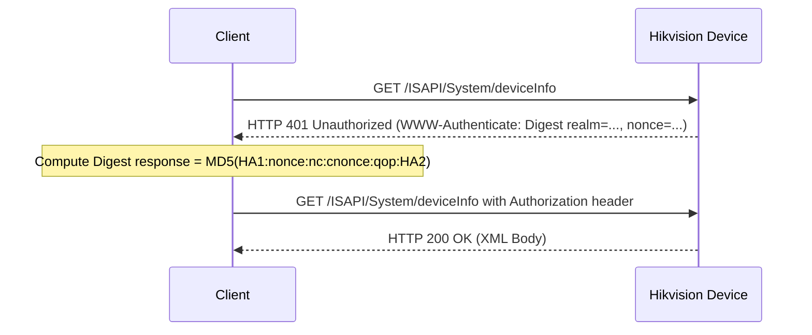

# Hikvision ISAPI Protocol Specification (Clean Room)

This document provides a clean-room specification of the **ISAPI (Intelligent Security API)** REST protocol implemented on Hikvision DVRs, NVRs, and IP cameras over standard HTTP/HTTPS.

By using this specification, developers can build applications across **Linux, macOS, Windows, Android, iOS, and embedded devices** without requiring proprietary SDK binaries (`HCNetSDK.dll`, ActiveX plugins, etc.).

---

## 1. Protocol Overview

- **Transport:** Standard HTTP / HTTPS (Default Port: 80 / 443)
- **Data Exchange Format:** XML (`application/xml; charset="UTF-8"`) and RESTful URI patterns
- **Authentication:** HTTP Digest Authentication (RFC 2617 / RFC 7616)
- **Media Stream Format:** Hikvision Program Stream (`IMKH` PS container, wrapping H.264 / H.265 elementary streams)

---

## 2. Authentication: HTTP Digest Flow

Hikvision devices protect all privileged ISAPI endpoints with standard HTTP Digest Authentication:



### Algorithm Calculation:
1. `HA1 = MD5(username + ":" + realm + ":" + password)`
2. `HA2 = MD5(method + ":" + uri)`
3. `Response = MD5(HA1 + ":" + nonce + ":" + nc + ":" + cnonce + ":" + qop + ":" + HA2)` (or `MD5(HA1 + ":" + nonce + ":" + HA2)` if no `qop`).

---

## 3. Cross-Firmware XML Namespace Architecture

Hikvision has produced several generations of ISAPI firmware. A common pitfall in third-party implementations is hardcoding the XML namespace:

| Firmware Generation | Example Tested Models | XML Namespace URI |
|:---|:---|:---|
| **V3.x (Classic)** | `DS-7116HQHI-K1` (build 170808) | `xmlns="http://www.std-cgi.com/ver20/XMLSchema"` |
| **V4.x+ (Modern)**  | `DS-7116HGHI-K1` (build 220610) | `xmlns="http://www.hikvision.com/ver20/XMLSchema"` |

### Best Practice for Parsers:
To ensure universal compatibility across both old and new firmwares, parse elements by their **local name** (ignoring the namespace prefix/URI):
```python
def lname(tag: str) -> str:
    return tag.rsplit('}', 1)[-1]
```

---

## 4. Track & Channel Numbering Scheme

Hikvision uses a predictable mathematical formula to map physical camera channels to logical stream tracks:

$$\text{TrackID} = (\text{ChannelIndex} \times 100) + \text{StreamProfile}$$

* $\text{StreamProfile} = 1$: **Main Stream** (High resolution, 1080p/720p/4K, full bitrate)
* $\text{StreamProfile} = 2$: **Sub Stream** (Low resolution, CIF/352x288, low bitrate for mobile)

### Channel Mapping Examples:
* **Camera 1:** Main Stream = `101`, Sub Stream = `102`
* **Camera 3:** Main Stream = `301`, Sub Stream = `302`
* **Camera 11:** Main Stream = `1101`, Sub Stream = `1102`
* **Camera 16:** Main Stream = `1601`, Sub Stream = `1602`

---

## 5. Recording Catalog Search (`CMSearchDescription`)

Searches the DVR hard disk for historical recorded segments within a UTC time window:

- **Method:** `POST /ISAPI/ContentMgmt/search`
- **Request Payload:**
```xml
<?xml version="1.0" encoding="utf-8"?>
<CMSearchDescription>
    <searchID>C1C1C1C1-0000-0000-0000-000000000001</searchID>
    <trackList>
        <trackID>101</trackID>
    </trackList>
    <timeSpanList>
        <timeSpan>
            <startTime>2026-10-14T00:00:00Z</startTime>
            <endTime>2026-10-14T23:59:59Z</endTime>
        </timeSpan>
    </timeSpanList>
    <maxResults>50</maxResults>
    <searchResultPostion>0</searchResultPostion>
    <metadataList>
        <metadataDescriptor>//recordType.meta.std-cgi.com</metadataDescriptor>
    </metadataList>
</CMSearchDescription>
```

- **Response Payload:** Contains `<searchMatchItem>` blocks with `<startTime>`, `<endTime>`, and `<playbackURI>`.

---

## 6. High-Speed Direct File Download (`downloadRequest`)

Downloads recorded video segments directly from internal storage sectors over HTTP:

- **Method:** `POST /ISAPI/ContentMgmt/download` (fallback: `/PSIA/Custom/SelfExt/ContentMgmt/download`)
- **Request Payload:**
```xml
<?xml version="1.0" encoding="utf-8"?>
<downloadRequest version="1.0" xmlns="http://urn:selfextension:psiaext-ver10-xsd">
    <playbackURI>rtsp://192.168.1.100:554/Streaming/tracks/101/?starttime=20261014T000000Z&endtime=20261014T010000Z&size=51162988</playbackURI>
</downloadRequest>
```

- **Throughput:**
  - **LAN (Gigabit/Fast Ethernet):** Up to **25+ MB/s** (~200 Mbps).
  - **WAN (Internet / Forwarded Port):** Saturates full upstream bandwidth (e.g. 2.6 – 5.0+ MB/s).

---

## 7. Media Container (`IMKH` Program Stream) & MP4 Remuxing

Downloaded footage arrives packaged in Hikvision's Program Stream container:
* **Magic Header (Bytes 0..3):** `0x49 0x4D 0x4B 0x48` (`IMKH`)
* **Payload:** Multiplexed PES packets containing H.264 or H.265 video frames and G.711 audio.

### Instant Lossless Remuxing to MP4:
```bash
ffmpeg -y -i input.ps -c copy output.mp4
```
Because the stream contains complete PES presentation timestamps (PTS), FFmpeg instantly demuxes the `IMKH` container and packages it into a playable `.mp4` file in milliseconds without re-encoding.
